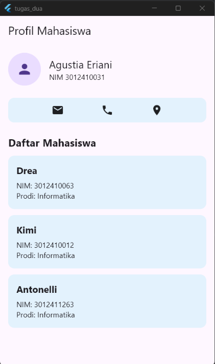
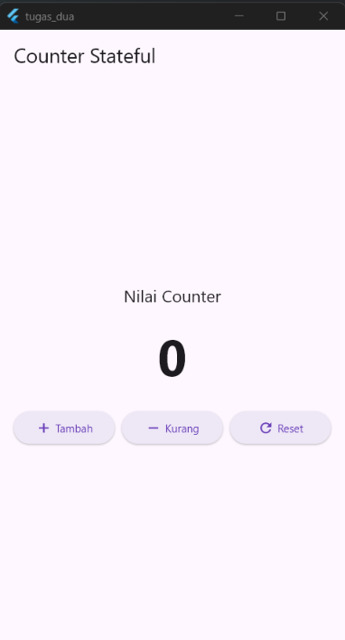

# Latihan Widget Dasar Flutter

Tugas **Pemrograman Aplikasi Mobile — Pertemuan 2**

## Hasil Pengerjaan

### 01. StatelessWidget — Kartu Mahasiswa dan Profil


### 02. StatefulWidget — Counter


## Struktur Folder

```text
tugas_2/
├── lib/
│   ├── Latihan/
│   ├── proof_of_work/
│   │   ├── result_stateful.png
│   │   └── result_stateless.png
│   └── main.dart
└── README.md
```
